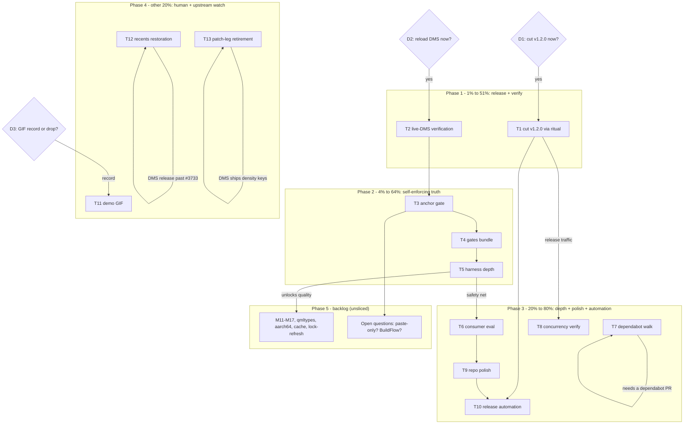

# Pareto Master Plan — Cycle 2 (dms-paste)

**Date:** 2026-10-17 09:35 CEST
**Input backlog:** [TODO_LIST.md](../../TODO_LIST.md) (14 rows, all verified open by docs-health audit #3 this morning — evidence anchors line-checked), [ROADMAP.md](../../ROADMAP.md) (4 themes + 2 open questions), status report [2026-10-17 09-29](../status/2026-10-17_09-29_docs-health-annotate-archive-sweep.md) §f. Predecessor plan: [2026-10-17 02-09 (Cycle 1)](archived/2026-10-17_02-09_pareto-master-plan.md) — fully executed/archived.
**Goal function:** convert the accumulated-but-unreleased trust work into a consumable release, close the one human verification gap, make every hand-maintained doc surface self-enforcing, then deepen verification and enrich snippets — while upstream convergence slowly shrinks the repo.
**Customer:** Lars today (`:s` reliability, honest docs); future flake consumers (pinnable tags, green CI); upstream DMS (contributions that retire patch legs).

## Pareto breakdown

### The 1% that delivers 51% — release + verify

- **Live-DMS verification (T2, 5 min, HUMAN).** Everything shipped since the SnippetsLogic extraction (6 checks, hardening, docs) rests behind one never-executed runtime boundary: `import "SnippetsLogic.js" as Logic` inside a live Quickshell session. qmllint proves parse-clean; node proves the logic (32 assertions); only your compositor proves the wiring. Cheapest possible unblock with the largest blast radius.
- **Cut v1.2.0 (T1, ~45 min).** Unreleased carries six checks + CI hardening + dependabot + today's doc sweep — real consumer value sitting invisible. A tag makes it pinnable; the run also exercises the brand-new AGENTS Release ritual once, so it stops being an untested instruction.

### The 4% that deliver 64% — self-enforcing truth surfaces

- **Anchor gate (T3).** FEATURES `file:line` evidence failed silently twice before audit #3 hand-verified it. One check leg (parse the Evidence column, assert the symbol at the cited line) makes that class of rot impossible; three consecutive sessions hand-verified anchors — gates > discipline.
- **Gates bundle (T4):** counts-sentence assert (the "No PLANNED/BROKEN/DISABLED" sentence is asserted by nothing today) + qml-preflight over `tests/fixtures/*.qml`.
- **Harness depth bundle (T5):** fuzz `parseScanRecords` round-trip incl. separator bytes + JSDoc the exports.

### The 20% that deliver 80% — contract depth + polish + automation

- **Consumer-shaped integration eval (T6):** module-contract against the real DMS HM closure — the stub-vs-real gap becomes mechanically known.
- **Dependabot end-to-end walk (T7)** — the documented SHA-verify-and-merge flow gets one real execution.
- **Concurrency-cancellation verify (T8)** — one engineered double-push, one observation.
- **Repo polish (T9):** GitHub topics + `docs/planning/` index (the symmetry gap audit #3 noticed).
- **Release automation (T10):** tag-push → GitHub Release from the CHANGELOG section; future releases become one push.

### The other 20% to reach 100%

Human-gated: demo GIF (T11, ~10 min of recording). Upstream-watch: recents restoration when a DMS release passes PR #3733 (T12 — latest release re-verified v1.6.3 at 09:35 today), patch-leg retirement when DMS ships modal-density keys (T13). ROADMAP raw ideas stay unsliced (M11–M17, qmltypes, aarch64, binary cache, lock-refresh) — they graduate through TODO_LIST when bounded. Open questions (paste-only vs more plugins; BuildFlow adoption) are user decisions, not tasks.

## Comprehensive plan — medium granularity (30–100 min each)

Sorted by importance / impact / effort / customer-value. Tier: P1 = 1%→51%, P2 = 4%→64%, P3 = 20%→80%, P4 = other 20%→100%.

| Rank | ID  | Task                                                                                                                                                                                     | Tier | Est (min)       | Impact             | Effort   | Customer value                         | Blocks/unlocks                 |
| ---- | --- | ---------------------------------------------------------------------------------------------------------------------------------------------------------------------------------------- | ---- | --------------- | ------------------ | -------- | -------------------------------------- | ------------------------------ |
| 1    | T1  | Decide + cut v1.2.0 via the AGENTS Release ritual (bump, CHANGELOG section, annotated tag, Release with how-to-consume, SECURITY row); amend ritual                                      | P1   | 45              | Very high          | Very low | Pinnable release; ritual validated     | Unlocks T10's first user       |
| 2    | T2  | Live-DMS verification of `:s` (human) + refresh FEATURES verification-basis wording; delete TODO row 4                                                                                   | P1   | 30              | Critical (trust)   | Very low | Daily-driver confidence re-established | Unblocks all shipped work      |
| 3    | T3  | FEATURES evidence anchor gate — parse Evidence column, assert symbol at cited line, prove-it-bites self-test, wire as `checks.anchors`                                                   | P2   | 75              | High               | Medium   | Doc rot class dead permanently         | Protects every future FEATURES |
| 4    | T4  | Gates bundle — counts-sentence assert in `features-counts.sh`; extend qml-preflight over `tests/fixtures/*.qml`                                                                          | P2   | 60              | Medium             | Low      | Both known gate gaps closed            | None                           |
| 5    | T5  | Harness depth — fuzz `parseScanRecords` (random content incl. `\x1e`/`\x1f`); JSDoc the SnippetsLogic exports                                                                            | P2   | 60              | Medium             | Low      | Framing safety net; editor ergonomics  | De-risks T14 richness work     |
| 6    | T6  | Consumer-shaped integration eval — module-contract vs the real DMS HM module closure in a scratch eval; record/fix gaps                                                                  | P3   | 60              | Medium             | Medium   | Contract gap mechanically known        | Hardens external consumers     |
| 7    | T7  | Dependabot end-to-end walk — verify incoming PR's SHA against the upstream tag object, merge, watch CI (time-gated: needs a PR)                                                          | P3   | 30              | Medium             | Low      | Documented flow validated once         | None                           |
| 8    | T8  | Concurrency-cancellation verify — engineered double-push, observe the superseded run cancel                                                                                              | P3   | 30              | Medium             | Very low | CI behavior observed, not assumed      | None                           |
| 9    | T9  | Repo polish — GitHub topics; `docs/planning/README.md` index (symmetry with docs/status)                                                                                                 | P3   | 30              | Low                | Very low | Landing/discoverability polish         | None                           |
| 10   | T10 | Release automation — tag-push workflow cutting the GitHub Release from the CHANGELOG section (dry-run tested)                                                                            | P4   | 60              | Medium             | Medium   | Future releases = one push             | Benefits from T1's learnings   |
| 11   | T11 | Demo GIF — record `:s` save→search→paste, optimize <2 MB, embed in README (human)                                                                                                        | P4   | 30              | Medium             | Medium   | Landing-page persuasion                | D3-gated                       |
| 12   | T12 | Recents restoration — re-check DMS releases on each announcement; when a post-#3733 cut ships: bump pin, re-add `savePluginState`, verify state file                                     | P4   | 60 (contingent) | Very high (UX)     | Medium   | The headline feature gap closes        | DMS release-gated              |
| 13   | T13 | Modal-layout watch — when DMS ships `itemHeight`/`previewLines`/`showTypeCaptions`: retire patch legs one per key, patch-contract stays green                                            | P4   | 30 (watch)      | Medium             | Low      | Repo shrinks as upstream grows knobs   | DMS-gated                      |
| 14   | T14 | ROADMAP raw ideas — placeholders, categories, edit-in-place, profiles, trigger option, upstream modal-density PR, DMS-collection proposal, qmltypes, aarch64, binary cache, lock-refresh | P4   | —               | Medium (long-term) | —        | PasteBot-parity+ and repo shrink       | Graduate via TODO_LIST         |
| 15   | T15 | Open questions — paste-only vs more plugins; BuildFlow adoption (user decisions, recorded in ROADMAP)                                                                                    | P4   | —               | —                  | —        | Direction certainty                    | User-gated                     |

**Decisions (user, gate the plan):** D1 cut v1.2.0 now? (gates T1; recommended: yes) · D2 reload DMS now? (gates T2; recommended: yes, 5 min) · D3 GIF: record or drop? (gates T11; recommended: record at next convenience).

## Fine breakdown — max 12 min per task

IDs map to the medium plan. ROADMAP raw ideas (T14) and decisions (T15) are intentionally NOT sliced — pre-slicing unrefined ideas is fake precision; they graduate through TODO_LIST when bounded.

### Phase 0 — decisions (user)

| ID  | Micro-task                             | Est (min) |
| --- | -------------------------------------- | --------- |
| 0.1 | D1: v1.2.0 now?                        | 2         |
| 0.2 | D2: reload DMS now + exercise `:s`?    | 3         |
| 0.3 | D3: GIF record / semi-automate / drop? | 2         |

### Phase 1 — 1%→51%: release + verify

| ID   | Micro-task                                                                               | Est (min) |
| ---- | ---------------------------------------------------------------------------------------- | --------- |
| 1.1  | T1: bump `plugins/snippets/plugin.json` version to 1.2.0                                 | 5         |
| 1.2  | T1: CHANGELOG — Unreleased → `## 1.2.0` section with date (insert-only edits)            | 10        |
| 1.3  | T1: `nix flake check` green; commit release prep                                         | 10        |
| 1.4  | T1: annotated tag `v1.2.0` from the section; push tag                                    | 8         |
| 1.5  | T1: GitHub Release `--verify-tag`; notes = section + README usage block (how-to-consume) | 12        |
| 1.6  | T1: SECURITY.md Supported Versions row → v1.2.0                                          | 5         |
| 1.7  | T1: amend AGENTS Release ritual where the run disagreed; TODO/CHANGELOG sync             | 10        |
| 1.8  | T2: reload DMS; exercise `:s` search / save / paste / delete (human)                     | 10        |
| 1.9  | T2: refresh FEATURES verification-basis wording (re-date the daily-driver claim)         | 10        |
| 1.10 | T2: delete TODO row (live-DMS); CHANGELOG entry; counts gate green                       | 8         |

### Phase 2 — 4%→64%: self-enforcing truth surfaces

| ID   | Micro-task                                                                                 | Est (min) |
| ---- | ------------------------------------------------------------------------------------------ | --------- |
| 2.1  | T3: spec the anchor gate — Evidence syntax, per-row symbol token, pass/fail rules          | 12        |
| 2.2  | T3: implement `tests/anchors.sh` (parse Evidence cells, resolve `file:line`, assert token) | 12        |
| 2.3  | T3: wire `checks.anchors` in flake.nix                                                     | 10        |
| 2.4  | T3: prove-it-bites self-test leg (doctored anchor copy must fail)                          | 12        |
| 2.5  | T3: run over FEATURES.md; fix anything it catches (it may find fresh drift)                | 12        |
| 2.6  | T4: counts-sentence assert — zeros in the table match the "No X" sentence                  | 12        |
| 2.7  | T4: sentence-leg self-test (doctored sentence fails)                                       | 8         |
| 2.8  | T4: qml-preflight over `tests/fixtures/*.qml` in the flake leg                             | 10        |
| 2.9  | T4: gates green; delete 2 TODO rows; CHANGELOG                                             | 10        |
| 2.10 | T5: fuzz design — properties (round-trip, separator-hostile content, TOO_LARGE framing)    | 10        |
| 2.11 | T5: implement fuzz cases in `run-tests.mjs` (deterministic seed)                           | 12        |
| 2.12 | T5: JSDoc the 5 SnippetsLogic exports                                                      | 12        |
| 2.13 | T5: gates green; delete 2 TODO rows; CHANGELOG                                             | 10        |

### Phase 3 — 20%→80%: contract depth + polish + automation

| ID   | Micro-task                                                                           | Est (min) |
| ---- | ------------------------------------------------------------------------------------ | --------- |
| 3.1  | T6: scratch eval skeleton importing the real DMS HM closure                          | 12        |
| 3.2  | T6: run eval; record stub-vs-real gaps                                               | 12        |
| 3.3  | T6: fix the module or record the known-gap note; TODO row closed                     | 12        |
| 3.4  | T7: when a dependabot PR exists: verify SHA vs upstream tag (`gh api /git/ref/tags`) | 12        |
| 3.5  | T7: merge; watch CI green; confirm pin updated; TODO row closed                      | 10        |
| 3.6  | T8: push commit A, immediately push commit B; observe the superseded run cancel      | 12        |
| 3.7  | T8: record observation; TODO row closed                                              | 8         |
| 3.8  | T9: `gh repo edit --add-topics` (candidates in TODO row)                             | 5         |
| 3.9  | T9: `docs/planning/README.md` index (mirrors docs/status convention)                 | 12        |
| 3.10 | T9: rows closed; CHANGELOG                                                           | 8         |
| 3.11 | T10: release workflow YAML (on tag push; extracts CHANGELOG section; dry-run flag)   | 12        |
| 3.12 | T10: dry-run test via workflow_dispatch on a throwaway tag; verify notes rendering   | 12        |
| 3.13 | T10: reference the workflow in the AGENTS ritual; ROADMAP idea retired               | 8         |

### Phase 4 — other 20%→100%: human-gated + upstream-watch

| ID   | Micro-task                                                                                       | Est (min) |
| ---- | ------------------------------------------------------------------------------------------------ | --------- |
| 4.1  | T11: record the GIF per TODO row steps (human)                                                   | 10        |
| 4.2  | T11: optimize <2 MB; store under `docs/assets/`                                                  | 10        |
| 4.3  | T11: embed in README landing; TODO row closed                                                    | 8         |
| 4.4  | T12: on each DMS release announcement: check for a post-#3733 cut (latest verified v1.6.3 09:35) | 5         |
| 4.5  | T12: if shipped — bump the consumer pin; update usage docs                                       | 12        |
| 4.6  | T12: re-add `savePluginState` + `loadPluginData` recents in SnippetsLauncher.qml                 | 12        |
| 4.7  | T12: verify `paste-snippets_state.json` lands; delete the in-memory workaround + comments        | 12        |
| 4.8  | T12: FEATURES row 5 → FULLY_FUNCTIONAL; counts line; CHANGELOG entry                             | 12        |
| 4.9  | T13: per upstream key shipped: retire the matching patch leg; patch-contract green; repeat ×3    | 12        |
| 4.10 | T14: when a richness idea is wanted: bound it, then graduate TODO_LIST → plan cycle 3            | 12        |

### Phase 5 — backlog (ROADMAP raw ideas — NOT sliced)

| ID   | Item                                    | Effort class | Prerequisite                |
| ---- | --------------------------------------- | ------------ | --------------------------- |
| 5.1  | M11 upstream modal-density settings PR  | M            | T5 harness depth            |
| 5.2  | M12 placeholders `{clipboard}`/`{date}` | M            | T5                          |
| 5.3  | M13 categories via subdirs              | M            | T5                          |
| 5.4  | M16 trigger as module option            | S            | —                           |
| 5.5  | M14 edit-in-place `$EDITOR`             | S            | —                           |
| 5.6  | M15 multiple dirs/profiles              | M            | M13                         |
| 5.7  | M17 propose plugin into DMS collection  | M            | T5 + stability              |
| 5.8  | Quickshell qmltypes typed linting       | M/L          | —                           |
| 5.9  | aarch64 CI leg                          | M            | arch-dependent check exists |
| 5.10 | CI binary cache                         | S            | run times grow              |
| 5.11 | Scheduled flake.lock refresh            | S            | T10 shipped                 |
| 5.12 | Open questions: paste-only? BuildFlow?  | user         | —                           |

## Execution graph

Dependency notes: T1 first among executable work (its release push can double as T8's double-push trigger); T2 is 5 human minutes and unblocks nothing but certifies everything; T3 before T4/T5 (its spec pattern is reused); T12/T13 are externally gated watches, not scheduleable; Phase 5 never blocks Phases 1–4.

## Errata / step-0 verification (2026-10-17 09:35)

- All 14 TODO rows re-verified open this morning by audit #3 (anchors line-checked; DMS latest re-confirmed v1.6.3 at 09:35). No shipped work lurks in the backlog.
- Cycle-1 plan fully executed and archived — no re-dispatch. New tasks beyond existing routing: T9's planning-index slice (was "next docs touch" in report 09-29 §f18) and T10 (graduates the ROADMAP repo-infra idea); both recorded here per the harvest rule.
- Working tree was clean at plan time (daemon commits `63c3aa9`/`b97d354` carry the 09-29 report + harvest).

## Verschlimmbesserung guards

- No task rewrites history: the tag annotates; nothing rebases; releases are cut from committed CHANGELOG text only.
- T12 deletes the in-memory workaround ONLY after the state file is verified to land (Cycle-1 guard, carried forward).
- T10's workflow must never create a Release for a tag without a matching CHANGELOG section — fail closed.
- ROADMAP ideas are not pre-sliced (fake precision is the failure mode this plan refuses).
- Every gate task (T3, T4, T5) ends with `nix flake check` green as its own verification step.
- The plan file is a snapshot; the living sources remain TODO_LIST.md / ROADMAP.md.
