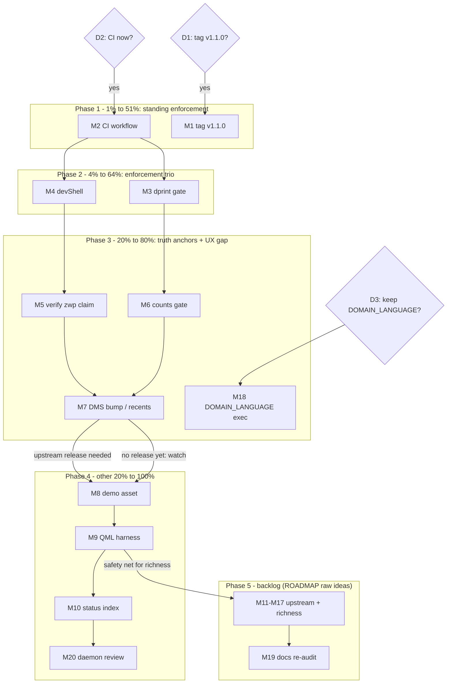

# Pareto Master Plan — dms-paste

**Date:** 2026-10-17 02:09 CEST
**Input backlog:** [TODO_LIST.md](../../TODO_LIST.md) (8 items, all verified open 02:09 — nothing shipped since the docs-health audit), [ROADMAP.md](../../ROADMAP.md) (9 raw ideas + 1 open question), status report `docs/status/2026-10-17_02-05_docs-health-audit.md` §f (22 items), and the 3 open user decisions from that report.
**Goal function:** keep Lars's daily-driver paste workflow reliable and make the repo safe/trustworthy to build on (CI, tags, gates, honest docs) — then enrich (PasteBot-parity and beyond).
**Customer:** Lars today (reliability of the `:s` workflow); future external consumers (trust signals: CI badge, tag, demo); upstream DMS (contributions).

## Pareto breakdown

### The 1% that delivers 51% — standing enforcement

**CI workflow (M2).** One ~40-line YAML file converts the entire existing gate suite (`module-contract`, `patch-contract`, `formatting`) from local-only ritual into standing protection on every push. Everything else in this plan is safer once it exists. The repo already has the checks — CI is pure leverage.

### The 4% that deliver 64% — the enforcement trio

- **CI (M2)** as above.
- **Non-nix formatting gate (M3):** markdown/json/yaml currently have a config (`dprint.json`) but zero enforcement; `nix flake check` gates nix only. One asymmetry, closed with one check leg.
- **devShell (M4):** pins the toolchain (dprint is today unpinned, invoked ad-hoc via `nix run nixpkgs#dprint`) so the gates are reproducible for any contributor.

### The 20% that deliver 80% — truth anchors + the biggest UX gap

- **Tag v1.1.0 (M1):** CHANGELOG and plugin.json both claim 1.1.0; no git tag exists. A tag makes the version real and pinnable.
- **Verify the virtual-keyboard protocol claim (M5):** the last honesty gap in live docs (`zwp_virtual_keyboard_manager_v1`, "works on niri" — provenance-corroborated only).
- **FEATURES counts gate (M6):** the "12 features — 10/1/1" line rots at the first feature change; mechanize it.
- **DMS bump / recents persistence (M7):** the single biggest UX gap (recents are session-scoped). Upstream-contingent — the actionable slice is release-check, pin-bump, then re-adding `savePluginState`.
- **DOMAIN_LANGUAGE decision execution (M18):** closes the last open decision.

### The other 20% to reach 100%

Demo asset (M8), QML pure-function harness (M9), status-report index (M10), daemon-commit review (M20), upstream contributions (M11), snippet richness (M12–M16), plugin-into-DMS-collection proposal (M17), and a docs re-audit once features land (M19).

## Comprehensive plan — medium granularity (30–100 min)

Sorted by importance / impact / effort / customer-value. Tier: P1 = 1%→51%, P2 = 4%→64%, P3 = 20%→80%, P4 = other 20%→100%.

| Rank                                                               | ID      | Task                                                                                                                                                             | Tier   | Est (min)        | Impact                         | Effort          | Customer value                                        | Blocks/unlocks              |
| ------------------------------------------------------------------ | ------- | ---------------------------------------------------------------------------------------------------------------------------------------------------------------- | ------ | ---------------- | ------------------------------ | --------------- | ----------------------------------------------------- | --------------------------- |
| ~~1~~ done at `782b857`                                            | ~~M2~~  | ~~CI workflow — `.github/workflows/check.yml`, nix install action + `nix flake check` on push/PR, watch first run green~~                                        | ~~P1~~ | ~~60~~           | ~~Very high~~                  | ~~Low~~         | ~~All future pushes protected; badge = trust signal~~ | ~~Protects M3+~~            |
| ~~2~~ done at `782b857`                                            | ~~M1~~  | ~~Tag v1.1.0 — annotated tag from CHANGELOG entry, push, fix "no git tags yet" note~~                                                                            | ~~P1~~ | ~~30~~           | ~~High~~                       | ~~Very low~~    | ~~Pinnable version for consumers~~                    | ~~None~~                    |
| ~~3~~ done at `a52a7d0`                                            | ~~M3~~  | ~~dprint formatting gate — `checks` leg running `dprint check` with pinned dprint~~                                                                              | ~~P2~~ | ~~60~~           | ~~High~~                       | ~~Low~~         | ~~Closes nix/non-nix enforcement asymmetry~~          | ~~Pairs with M2~~           |
| ~~4~~ done at `a52a7d0`                                            | ~~M4~~  | ~~devShell — `devShells.default` with pinned dprint (+ treefmt wrapper)~~                                                                                        | ~~P2~~ | ~~45~~           | ~~Medium-high~~                | ~~Low~~         | ~~Reproducible toolchain; onboarding~~                | ~~Enables M3 ergonomics~~   |
| 5 **→ TODO_LIST (recents row — watch-mode, upstream not shipped)** | M7      | DMS bump / recents persistence — check releases for post-#3733 cut; if consumable: bump pin, re-add `savePluginState`, verify state file; else record watch date | P3     | 100 (contingent) | Very high (UX)                 | Medium          | The headline feature gap closes                       | DMS release-gated           |
| ~~6~~ done at `a52a7d0`                                            | ~~M5~~  | ~~Verify `zwp_virtual_keyboard_manager_v1` + niri claim against DMS source; README cadence note~~                                                                | ~~P3~~ | ~~45~~           | ~~Medium~~                     | ~~Low~~         | ~~Docs stop resting on provenance~~                   | ~~None~~                    |
| ~~7~~ done at `a52a7d0`, `5fb5080`                                 | ~~M6~~  | ~~Mechanize FEATURES.md counts — check leg re-derives row counts~~                                                                                               | ~~P3~~ | ~~45~~           | ~~Medium~~                     | ~~Low~~         | ~~Count line can't rot~~                              | ~~After M3 pattern~~        |
| ~~8~~ done at `57e2168`                                            | ~~M18~~ | ~~Execute DOMAIN_LANGUAGE decision — keep (close) or drop (trash + re-point AGENTS.md)~~                                                                         | ~~P3~~ | ~~15~~           | ~~Low-medium~~                 | ~~Very low~~    | ~~Removes last open decision~~                        | ~~D3-gated~~                |
| 9 **→ TODO_LIST (demo asset row)**                                 | M8      | README demo asset — record `:s` save→search→paste GIF, embed                                                                                                     | P4     | 60               | Medium                         | Medium          | Landing-page persuasion                               | None                        |
| ~~10~~ done at `9d7b9d5`                                           | ~~M9~~  | ~~QML pure-function harness — extract score/slugify/framing to testable JS, nix check leg~~                                                                      | ~~P4~~ | ~~100~~          | ~~Medium-high (long-term)~~    | ~~Medium-high~~ | ~~Richness features get a safety net~~                | ~~Unlocks M12–M16 quality~~ |
| ~~11~~ done at `57e2168`                                           | ~~M10~~ | ~~docs/status index — README.md listing reports~~                                                                                                                | ~~P4~~ | ~~30~~           | ~~Low~~                        | ~~Very low~~    | ~~Future audits find reports~~                        | ~~At ≥3 reports~~           |
| ~~12~~ done at `1197c32`                                           | ~~M20~~ | ~~Daemon commit `497f1f9` review — reflog-check the message/hash change, note or escalate~~                                                                      | ~~P4~~ | ~~15~~           | ~~Low~~                        | ~~Very low~~    | ~~History trust~~                                     | ~~None~~                    |
| 13 **→ ROADMAP (upstream convergence)**                            | M11     | Upstream PR: modal-density settings for DMS (`itemHeight`/`previewLines`/`showTypeCaptions`)                                                                     | P4     | 100              | Medium (ecosystem)             | Medium          | Retires patch legs long-term                          | Best after M9               |
| 14 **→ ROADMAP (placeholders)**                                    | M12     | Snippet placeholders (`{clipboard}`, `{date}`)                                                                                                                   | P4     | 100              | Medium                         | Medium          | PasteBot-parity+                                      | After M9                    |
| 15 **→ ROADMAP (categories)**                                      | M13     | Categories via subdirectories / filename conventions                                                                                                             | P4     | 100              | Medium                         | Medium          | Organization at scale                                 | After M9                    |
| 16 **→ ROADMAP (trigger option)**                                  | M16     | Trigger as module option (`:s` configurable)                                                                                                                     | P4     | 60               | Low-medium                     | Low             | Personalization                                       | None                        |
| 17 **→ ROADMAP (edit-in-place)**                                   | M14     | Edit-in-place via `$EDITOR` + rescan                                                                                                                             | P4     | 60               | Low-medium                     | Low             | Snippet lifecycle completes                           | None                        |
| 18 **→ ROADMAP (profiles)**                                        | M15     | Multiple snippet directories / profiles                                                                                                                          | P4     | 90               | Low-medium                     | Medium          | Work/personal split                                   | After M13                   |
| 19 **→ ROADMAP (bundled-collection idea)**                         | M17     | Propose plugin for DMS bundled collection                                                                                                                        | P4     | 90               | Low-medium (now), high (later) | Medium          | Repo shrinks to settings+patches                      | After M9+M12 stability      |
| ~~20~~ done at `5fb5080`                                           | ~~M19~~ | ~~Docs re-audit (docs-health) after next feature lands — baseline Accuracy 7.0 / Fitness 5.5 exists~~                                                            | ~~P4~~ | ~~60~~           | ~~Medium~~                     | ~~Low~~         | ~~Docs stay honest~~                                  | ~~Last~~                    |

**Decisions (user, 0 min, gate the plan):** D1 tag policy (gates M1) · D2 CI timing (gates M2) · D3 DOMAIN_LANGUAGE keep/drop (gates M18). Recommended defaults: yes / now / keep.

## Fine breakdown — max 12 min per task

Phases follow the tiers. IDs map to the medium plan. ROADMAP raw ideas (M11–M17) are intentionally NOT sliced into 12-min pieces — pre-slicing unrefined ideas is fake precision (verschlimmbesserung); they graduate through TODO_LIST when bounded.

### Phase 0 — decisions (user)

| ID                                   | Micro-task                                        | Est (min) |
| ------------------------------------ | ------------------------------------------------- | --------- |
| ~~0.1~~ done at `782b857`, `57e2168` | ~~Answer D1/D2/D3 (tag? CI now? keep glossary?)~~ | ~~2~~     |

### Phase 1 — 1%→51%: standing enforcement

| ID                        | Micro-task                                                                                                 | Est (min) |
| ------------------------- | ---------------------------------------------------------------------------------------------------------- | --------- |
| ~~1.1~~ done at `782b857` | ~~M2: decide trigger scope (push to master + PRs)~~                                                        | ~~3~~     |
| ~~1.2~~ done at `782b857` | ~~M2: write `.github/workflows/check.yml` (nix-installer action, `nix flake check`)~~                      | ~~10~~    |
| ~~1.3~~ done at `782b857` | ~~M2: decide systems strategy (default systems on x86_64 runner; aarch64 needs binfmt — defer with note)~~ | ~~5~~     |
| ~~1.4~~ done at `782b857` | ~~M2: commit + push, watch first Actions run~~                                                             | ~~10~~    |
| ~~1.5~~ done at `782b857` | ~~M2: fix first-run issues if any~~                                                                        | ~~12~~    |
| ~~1.6~~ done at `782b857` | ~~M2: add CI badge to README~~                                                                             | ~~5~~     |
| ~~1.7~~ done at `782b857` | ~~M1: draft annotated tag message from CHANGELOG 1.1.0~~                                                   | ~~5~~     |
| ~~1.8~~ done at `782b857` | ~~M1: `git tag -a v1.1.0` + push tag~~                                                                     | ~~3~~     |
| ~~1.9~~ done at `782b857` | ~~M1: verify tag on GitHub; update CHANGELOG "no git tags yet" note + TODO/FEATURES rows~~                 | ~~8~~     |

### Phase 2 — 4%→64%: enforcement trio

| ID                        | Micro-task                                                                                | Est (min) |
| ------------------------- | ----------------------------------------------------------------------------------------- | --------- |
| ~~2.1~~ done at `a52a7d0` | ~~M3: pick dprint pin strategy (nixpkgs `dprint` package version)~~                       | ~~5~~     |
| ~~2.2~~ done at `a52a7d0` | ~~M3: add `checks.dprint` runCommand running `dprint check` (fmt config already exists)~~ | ~~12~~    |
| ~~2.3~~ done at `a52a7d0` | ~~M3: run `dprint fmt`, fix violations, `nix flake check` green~~                         | ~~8~~     |
| ~~2.4~~ done at `a52a7d0` | ~~M3: update AGENTS.md Verification section + TODO_LIST row~~                             | ~~6~~     |
| ~~2.5~~ done at `a52a7d0` | ~~M4: add `devShells.default` (dprint + formatter wrapper)~~                              | ~~10~~    |
| ~~2.6~~ done at `a52a7d0` | ~~M4: enter shell, verify dprint on PATH, format idempotent~~                             | ~~5~~     |
| ~~2.7~~ done at `a52a7d0` | ~~M4: document devShell in README Development section~~                                   | ~~5~~     |

### Phase 3 — 20%→80%: truth anchors + UX gap

| ID                                                                                                   | Micro-task                                                                                         | Est (min) |
| ---------------------------------------------------------------------------------------------------- | -------------------------------------------------------------------------------------------------- | --------- |
| ~~3.1~~ done at `a52a7d0`                                                                            | ~~M5: locate DMS source for send-paste / virtual keyboard usage~~                                  | ~~10~~    |
| ~~3.2~~ done at `a52a7d0`                                                                            | ~~M5: confirm protocol string + niri path; capture source links~~                                  | ~~10~~    |
| ~~3.3~~ done at `a52a7d0`                                                                            | ~~M5: update README claim + add re-verify cadence note~~                                           | ~~5~~     |
| ~~3.4~~ done at `a52a7d0`                                                                            | ~~M6: choose counts-gate mechanism (parse FEATURES table in a check leg)~~                         | ~~5~~     |
| ~~3.5~~ done at `a52a7d0`                                                                            | ~~M6: implement the derivation + test~~                                                            | ~~12~~    |
| ~~3.6~~ done at `a52a7d0`, `bd33755`                                                                 | ~~M6: `nix flake check` green; fix counts if drifted~~                                             | ~~5~~     |
| ~~3.7~~ done at `57e2168`                                                                            | ~~M7: check DMS releases/tags for a cut containing #3733~~                                         | ~~5~~     |
| ~~3.8~~ **NOT-DO — collapsed to 3.12 — upstream had not shipped (the plan's own dependency note).**  | ~~M7 (if yes): bump the DMS pin / consumer instructions~~                                          | ~~10~~    |
| ~~3.9~~ **NOT-DO — collapsed to 3.12 — upstream had not shipped (the plan's own dependency note).**  | ~~M7 (if yes): re-add `savePluginState` + `loadPluginData` recents in `SnippetsLauncher.qml`~~     | ~~10~~    |
| ~~3.10~~ **NOT-DO — collapsed to 3.12 — upstream had not shipped (the plan's own dependency note).** | ~~M7 (if yes): verify `~/.local/state/DankMaterialShell/plugins/paste-snippets_state.json` lands~~ | ~~10~~    |
| ~~3.11~~ **NOT-DO — collapsed to 3.12 — upstream had not shipped (the plan's own dependency note).** | ~~M7: update TODO/FEATURES/CHANGELOG; delete workaround comments~~                                 | ~~10~~    |
| ~~3.12~~ done at `57e2168`                                                                           | ~~M7 (if no): record watch date + next check cadence in TODO row~~                                 | ~~3~~     |
| ~~3.13~~ done at `57e2168`                                                                           | ~~M18: execute D3 outcome (keep → close; drop → trash + re-point AGENTS.md)~~                      | ~~6~~     |

### Phase 4 — other 20%→100%

| ID                                   | Micro-task                                                                            | Est (min) |
| ------------------------------------ | ------------------------------------------------------------------------------------- | --------- |
| 4.1 **→ TODO_LIST (demo asset row)** | M8: record `:s` save→search→paste GIF                                                 | 10        |
| 4.2 **→ TODO_LIST (demo asset row)** | M8: optimize/resize, store under `docs/assets/`                                       | 10        |
| 4.3 **→ TODO_LIST (demo asset row)** | M8: embed in README landing section                                                   | 5         |
| ~~4.4~~ done at `9d7b9d5`            | ~~M9: extract pure JS (score/slugify/framing) into importable `.js`~~                 | ~~12~~    |
| ~~4.5~~ done at `9d7b9d5`            | ~~M9: test runner shell (node or `runCommand`)~~                                      | ~~12~~    |
| ~~4.6~~ done at `9d7b9d5`            | ~~M9: tests — scoring tiers, slugify edge cases, framing round-trip incl. TOO_LARGE~~ | ~~12~~    |
| ~~4.7~~ done at `9d7b9d5`            | ~~M9: wire as `checks.plugin-logic`; flake check green~~                              | ~~10~~    |
| ~~4.8~~ done at `57e2168`            | ~~M10: create `docs/status/README.md` index + row for report #1~~                     | ~~10~~    |
| ~~4.9~~ done at `1197c32`            | ~~M20: `git reflog` inspect `676a97c`/`497f1f9`; note finding~~                       | ~~8~~     |

### Phase 5 — backlog (ROADMAP raw ideas — NOT sliced; graduate via TODO_LIST when bounded)

| ID                                          | Item                                               | Effort class | Prerequisite          |
| ------------------------------------------- | -------------------------------------------------- | ------------ | --------------------- |
| 5.1 **→ ROADMAP (modal-density PR)**        | M11 upstream modal-density settings PR             | M            | M9                    |
| 5.2 **→ ROADMAP (placeholders)**            | M12 placeholders `{clipboard}`/`{date}`            | M            | M9                    |
| 5.3 **→ ROADMAP (categories)**              | M13 categories via subdirs                         | M            | M9                    |
| 5.4 **→ ROADMAP (trigger option)**          | M16 trigger as module option                       | S            | —                     |
| 5.5 **→ ROADMAP (edit-in-place)**           | M14 edit-in-place `$EDITOR`                        | S            | —                     |
| 5.6 **→ ROADMAP (profiles)**                | M15 multiple dirs/profiles                         | M            | M13                   |
| 5.7 **→ ROADMAP (bundled-collection idea)** | M17 propose plugin into DMS collection             | M            | M9 + stability        |
| ~~5.8~~ done at `5fb5080`                   | ~~M19 docs re-audit~~                              | ~~S~~        | ~~Next feature ship~~ |
| 5.9 **→ ROADMAP (open questions)**          | ROADMAP open question: more plugins or paste-only? | user         | —                     |

## Execution graph

Dependency notes: M2 first (it protects every later commit); M3+M4 parallel after M2; M7 is externally gated — its micro-tasks 3.8–3.11 collapse to 3.12 (watch) when upstream hasn't shipped; M9 is the prerequisite that turns ROADMAP richness items from risky into routine.

## Errata / step-0 verification (2026-10-17 02:09)

- All 8 TODO_LIST items re-verified open against the repo (`git log` unchanged since the docs-health audit; CHANGELOG has no newer entries; no `.github/`, no tags, no devShell, no dprint check — confirmed by direct inspection).
- No prior plans exist in `docs/planning/` (this is #1) — nothing to re-dispatch.
- New tasks surfaced by this plan beyond existing routing: none — M10 (status index) and M20 (daemon review) were already carried as deferred items/observations in the status report §f; they stay condition-gated there rather than inflating TODO_LIST.

## Verschlimmbesserung guards

- No task rewrites history (tag annotates; nothing rebased).
- M7 deletes the in-memory workaround ONLY after the state file is verified to land.
- ROADMAP ideas are not pre-sliced (fake precision is the failure mode this plan refuses).
- Every gate task (M2, M3, M6, M9) ends with `nix flake check` green as its own verification step.
- The plan file is a snapshot; the living sources remain TODO_LIST.md / ROADMAP.md.
